<div align="center">

# 奶蛙：裂境巡游
### Naiwa: Riftbound

**把桌面上的碎片，变成裂境里的力量。**

桌宠陪伴 × 文件回收成长 × 四境横版战斗 × 魔神觉醒

[开始游玩](https://lty4869822.github.io/naiwa-riftbound/) · [下载版本](https://github.com/LTY4869822/naiwa-riftbound/releases) · [新手指南](docs/GETTING_STARTED.md) · [玩法手册](docs/GAMEPLAY.md) · [开发与构建](docs/DEVELOPMENT.md) · [素材与许可](THIRD_PARTY_NOTICES.md)

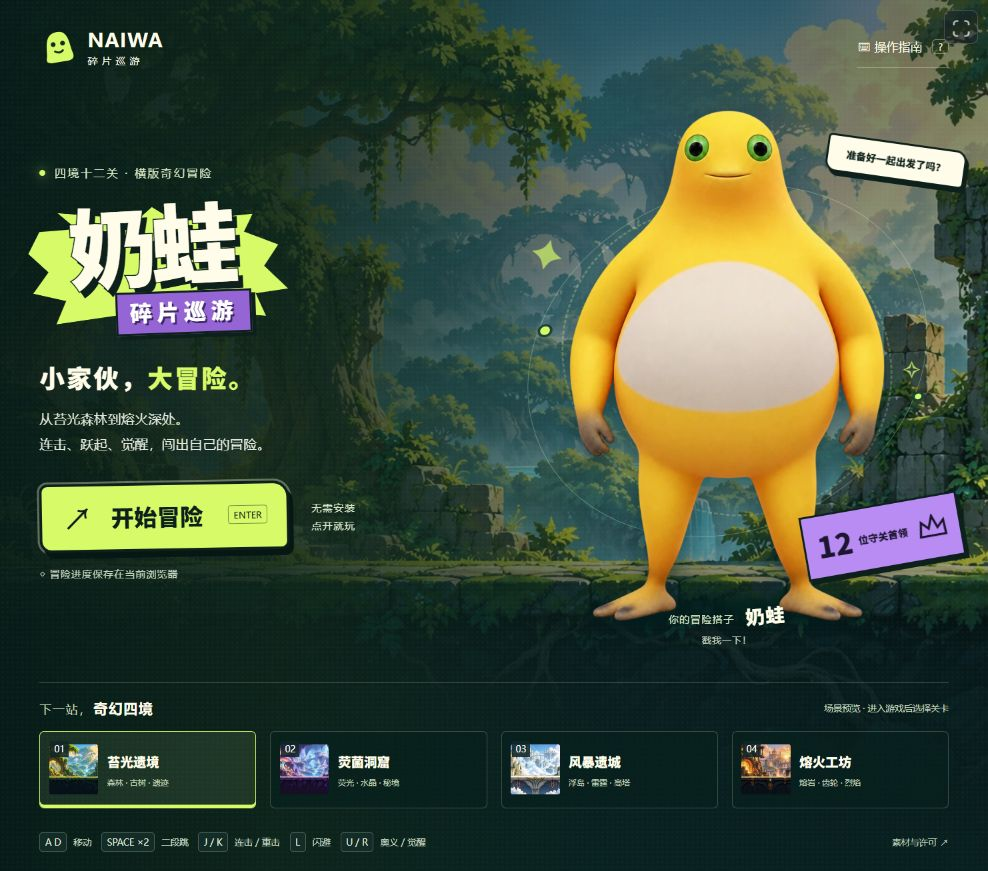

</div>

> **开发中预览版 · v0.1.0-preview.1**  
> 这是一款将 Windows 桌面陪伴和横版动作冒险结合的实验游戏。工程当前界面沿用「奶蛙 · 碎片巡游」名称；GitHub 项目定名为《奶蛙：裂境巡游》。  
> 角色与部分素材有独立授权限制，完整游戏不是可以一概按 MIT 商用的素材包。请先阅读[许可说明](LICENSE.md)。

## 先看实际效果

以下游戏画面于 **2026-11-02 从当前工程重新录制**，对应[源码版本指纹](docs/validation/source-version.json)。四境场景、二段跳、遗物票券和 PixelFX 命中表现均来自当前运行代码。为清楚展示动作，部分截图/动图采用关闭存档、布置敌人和高血量靶的展示场景，不代表正常开局等级或整局自然通关。

### 连击、重击与奥义

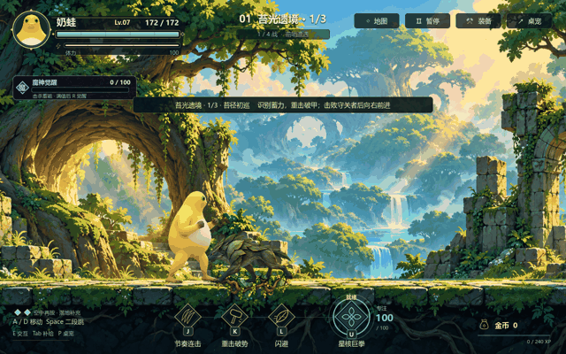

每次真实命中驱动火花、受击闪色、方向反冲和分级停顿。普通攻击、破甲、重击、受伤和奥义使用不同配色与声音层次。

| 二段跳 | 魔神觉醒 |
| --- | --- |
| 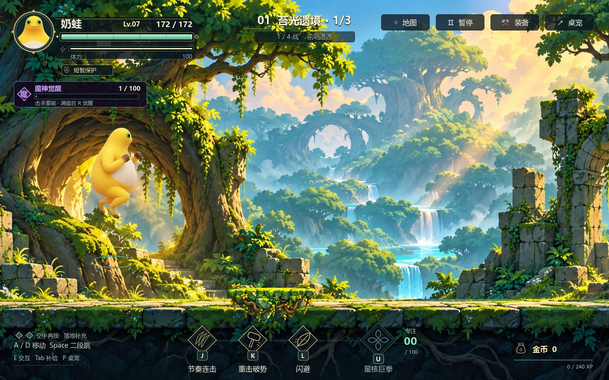 | 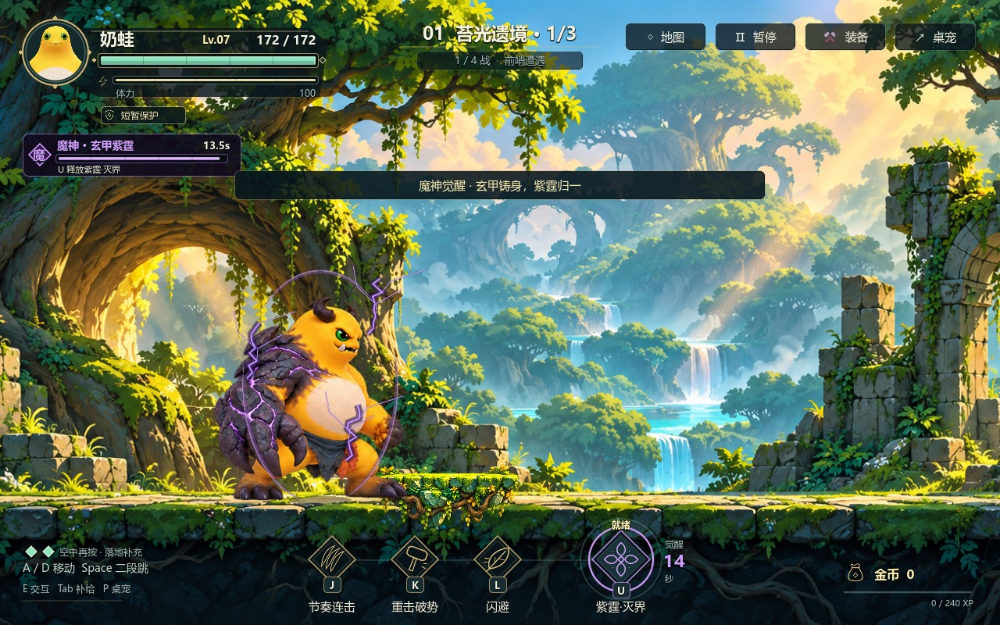 |

### 同一个世界，不同的战场

| 苔光遗境 | 荧菌洞窟 |
| --- | --- |
| 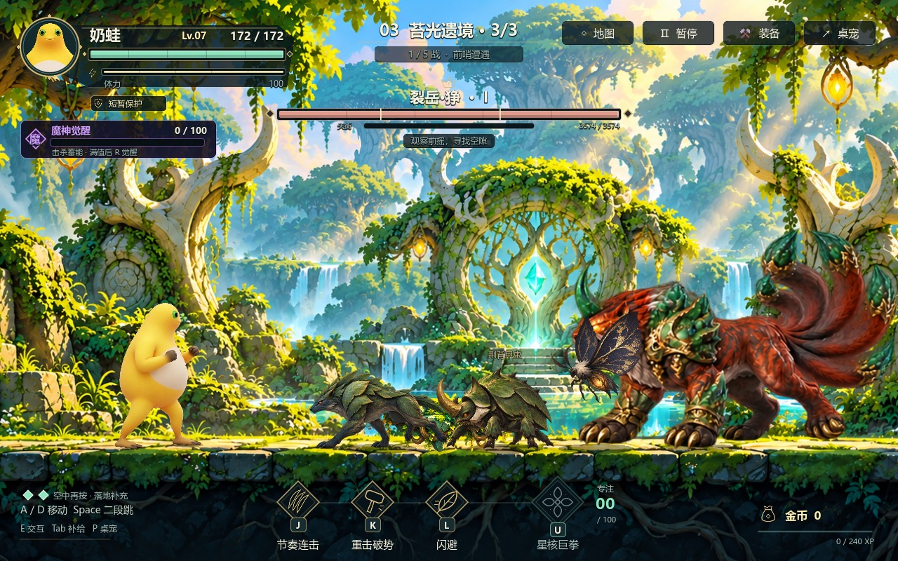 | 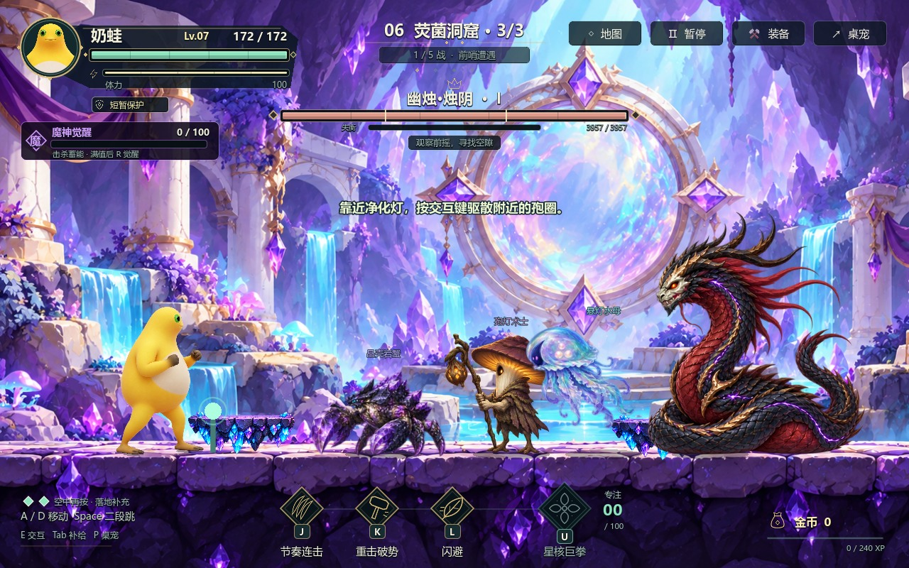 |
| 风暴遗城 | 熔火工坊 |
| 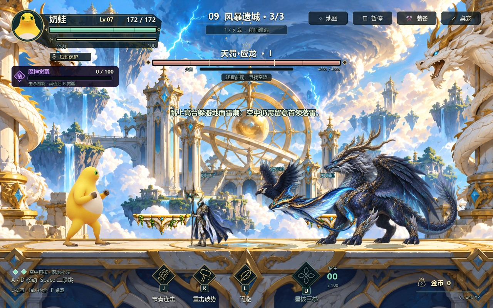 | 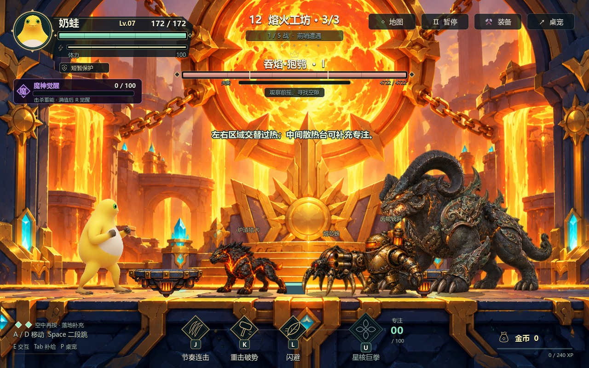 |

### 一次选择，改变接下来的打法

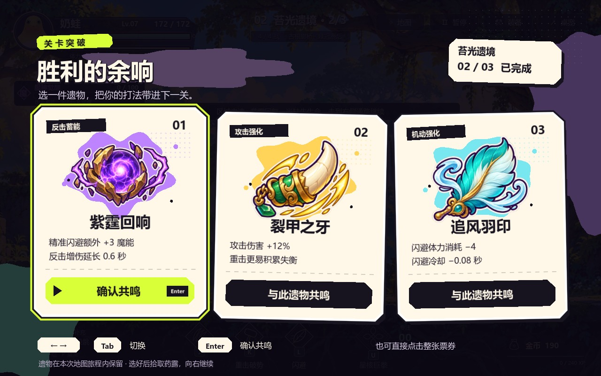

| 正面角色主菜单 | 皮肤商城界面 |
| --- | --- |
| 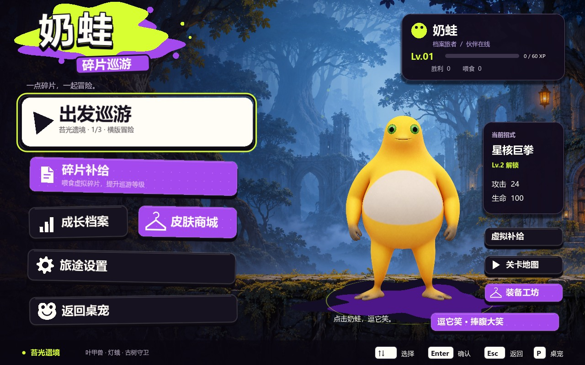 | 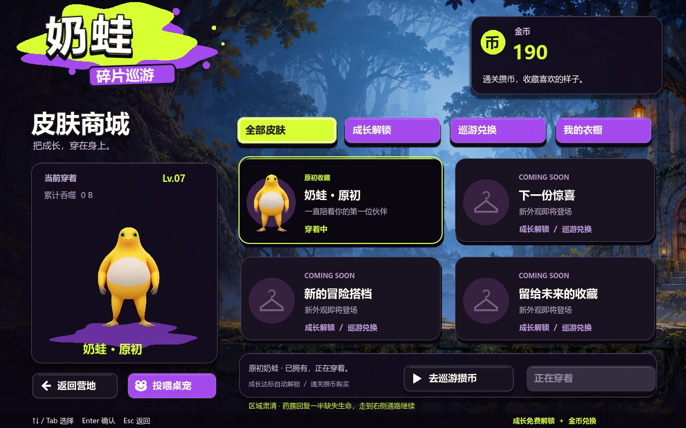 |

商城的成长/金币解锁与装备判定已经接入。**当前实装可装备的皮肤是原初奶蛙**，其余位置为后续皮肤预留，不将占位项当作已完成皮肤出售。

## 这是什么游戏

奶蛙平时是一只可以拖动、互动和大笑的桌宠。Windows 版中，把不需要的文件或文件夹拖给它，成功移入系统回收站后，按文件的实际字节数累计成长。进入游戏后，同一份成长等级会影响奶蛙的基础战斗能力。

战斗部分是四张地图、每图三段相连的横版冒险。每段有自己的场景与守关 Boss。玩家通过走位、连击、重击、二段跳和闪避寻找输出窗口，拾取敌人掉落的金币，在关尾选择遗物、拾取药露，再继续深入。击杀积攒魔能，蓄满后可以觉醒为岩甲巨爪形态。

**陪伴、清理和冒险是一个循环，但两种资源各有用途：**

- **回收字节 → 经验与等级**：文件大小参与成长，文件名或分类不决定经验。
- **战斗掉落/通关 → 金币**：用于装备升级及后续皮肤购买。
- **击杀与战斗事件 → 魔能**：用于单次觉醒，不等于桌面回收经验。
- **关尾遗物 → 本次地图旅程加成**：影响重击、闪避、反击或恢复方式。

## 当前已经实现

### 1. 有互动的桌面搭子

- Windows 桌宠以 [LIN4RUN/naiwa-desktop-pet](https://github.com/LIN4RUN/naiwa-desktop-pet) 为基础接入。
- 保留原桌宠的待机、视线、拖动、大笑及丰富动作资源。
- 拖入文件后显示投喂与成长反馈。
- 桌宠和 Godot 游戏之间可以进入、返回和恢复同一个游戏进程。
- 游戏关闭或异常退出时有桌宠恢复路径；全屏隐藏和拖放可见性做过专项修复。

### 2. 按实际大小成长

- 实际回收成功后才生成成长回执；取消或失败不会当作已经吞食。
- Godot 读取回执并维护等级，桌宠读取同一份成长结果。
- 回执有去重账本，重复导入同一回执不应反复加经验。
- 默认 **8 MiB = 1 XP**，不足部分保留，累计到下一单位继续兑换。
- 当前升级门槛是 **60 + (等级 − 1) × 30 XP**，因此从 Lv.1 升到 Lv.2 需要累计 480 MiB 的有效回收量。
- 统计的是文件大小，不是释放的物理内存或系统实时 RAM。

### 3. 四境十二关

- 四套场景主题、十二个独立场景。
- 每图三关相连，生命与旅程状态延续。
- 各图使用不同的三种小兵阵容，不跨地图复用同一组小兵。
- 每关有独立守关 Boss；各图终关是山海异兽方向的首领。
- 小兵波次和技能层级逐关增加；Boss 生命、伤害与招式阶段继续叠加压力。

### 4. 动作与战斗

- 左右移动、八帧侧身移动和带风感的疾跑表现。
- 跳跃、空中二段跳、落地补充跳跃次数。
- 节奏普攻、重击破势、闪避与专注奥义。
- 精准闪避、反击机会、失衡与恢复窗口。
- 击杀蓄满魔能后，释放带衔接阶段的觉醒；强化形态有独立动作与终结表现。
- 敌人使用近战、冲撞、远射、散射、追击、地面区域攻击等不同招式。

### 5. 有辨识度的 Boss

- 通过裂缝揭露和入场编排登场。
- 按玩家距离、运动和攻击状态评分选招，并抑制连续重复同一招。
- 随生命阶段解锁更多动作与攻击组合。
- 目标预警、攻击爆发、落地烟尘和收招窗口分开呈现。
- 狰、烛阴、应龙和狍鸮有各自的视觉主题与大招表现。

### 6. 战利品、恢复和装备

- 敌人死亡后产生可拾取金币，不是只在结算中改一个数字。
- 紫金纹章币、翡翠药露具有悬浮、吸收、拾取光点和独立音效。
- 关尾药露默认恢复 **50% 缺失生命**，不会每关直接回满；遗物可改变恢复比例。
- 三件遗物中选择一件，效果保留到本次地图旅程结束。
- 装备工坊消耗金币提升装备，商城预留成长解锁与金币购买两条路径。

### 7. 声画反馈与界面

- 参考喷墨、贴纸、粗描边、硬投影与回弹触感制作菜单及遗物 UI。
- 人物生命、体力、魔能、专注、Boss 状态与技能提示绑定实际数据。
- 基于 [PixelFX](https://github.com/patch-gg/pixelfx) 配方接入金绿火花、紫霆爆点、破甲环与地面碎石。
- 按真实扣血事件触发命中反馈，避免空挥也播放命中爆点。
- 分级停顿、方向镜头反冲、受击闪色、弹跳伤害数字及命中音效变体。
- 支持减少动态和声音设置；网页封面提供系统减少动态适配。

## 地图与守关者

| 地图 | 第1关 | 第2关 | 第3关 | 本图小兵 |
| --- | --- | --- | --- | --- |
| 苔光遗境 | 苔径初巡 · 古树守卫 | 古根廊桥 · 棘冠鹿后 | 翡翠鹿坛 · 裂岳·狰 | 苔甲猎手、荆背甲虫、灯蛾 |
| 荧菌洞窟 | 菌灯引路 · 荧冠菌王 | 晶河穹窟 · 镜丝蛛后 | 幽镜神殿 · 幽烛·烛阴 | 晶壳岩蟹、孢灯术士、悬灯水母 |
| 风暴遗城 | 断塔前哨 · 雷翼君王 | 悬钟云桥 · 鸣钟巨灵 | 苍龙雷坛 · 天罚·应龙 | 风刃卫、夜羽鸦、天帆鳐 |
| 熔火工坊 | 炉心初燃 · 熔炉巨像 | 齿轮铸坊 · 熔轮暴君 | 锁链炉心 · 吞焰·狍鸮 | 炉渣猎犬、熔芯蛛、齿轮铳兵 |

阵容和场景的权威配置在 [biomes/content.gd](prototype/biomes/content.gd)，关卡成长系数在 [campaign/levels.gd](prototype/campaign/levels.gd)。每图三关的小兵数量依次为 **6 / 9 / 13**，最后追加该关 Boss。

## 怎么开始玩

### 浏览器版

1. 打开[在线试玩](https://lty4869822.github.io/naiwa-riftbound/)。
2. 点击「开始冒险」，首次等待约49 MiB游戏资源载入。
3. 进入原来的正常游戏首页，再选择地图/出发。
4. 点一下画面以启用操作与声音；手机横屏后，在战斗中显示触屏按键。

也可以从 [Releases](https://github.com/LTY4869822/naiwa-riftbound/releases) 下载网页版 ZIP，解压后启动本地 HTTP 服务：

```bash
python -m http.server 8765 --bind 127.0.0.1
```

然后访问 `http://127.0.0.1:8765/`。请不要双击 `index.html` 以 `file://` 方式运行。

**网页版只提供浏览器内的游戏与虚拟补给，不访问电脑回收站。** 存档保存在当前浏览器/域名下，不与 Windows 版、其他浏览器或其他站点自动同步。

### Godot 源码版

1. 克隆仓库，安装 [Godot 4.7.2 Standard](https://godotengine.org/download/archive/4.7.2-stable/)。
2. 在 Godot 中导入 `prototype/project.godot`，等待资源导入完成。
3. 按 F6 只运行当前场景，或按 **F5** 从默认正常首页运行完整项目。
4. 实际默认入口是 `res://v6/slice.tscn`，不是旧版二维验证场或特效演示场。

### Windows 桌宠联动版

需要 Windows 10/11、Python 3.12、.NET Framework 4.x 和 Godot 4.7.2。详见[新手指南](docs/GETTING_STARTED.md)的完整准备步骤。桌宠的原始大体积动作包和编译器从固定的官方发行包下载，不重复塞进 Git 历史。

## 键位

| 按键 | 功能 |
| --- | --- |
| A / D | 左右移动 |
| Space | 跳跃；空中再次按下二段跳 |
| J | 节奏连击 |
| K | 重击 / 破势 |
| L / Shift | 闪避 |
| U | 星核巨拳；觉醒状态的终结动作按当前技能提示 |
| R | 魔能蓄满、落地站稳后觉醒 |
| E | 关卡内交互 |
| Tab | 补给/营地，按当前界面提示 |
| Esc | 暂停 / 继续 |
| P | Windows 返回桌宠；网页返回首页 |
| 方向键 / Tab / Enter | 菜单焦点与确认 |

某些隔离演示使用 F1–F12 切换展示目标，它们属于演示入口，不是正式战斗快捷键。

## 三种运行方式的区别

| 能力 | 网页版 | Godot 单独运行 | Windows 桌宠联动 |
| --- | --- | --- | --- |
| 四境十二关与战斗 | ✅ | ✅ | ✅ |
| 二段跳 / 觉醒 / 遗物 / 金币 | ✅ | ✅ | ✅ |
| 游戏内虚拟补给 | ✅ | ✅ | ✅ |
| 真实文件投喂与系统回收站 | — | 需要桌宠生成回执 | ✅ |
| 桌面拖动、大笑和动作 | — | — | ✅ |
| 浏览器触屏按键 | ✅ | — | — |
| 成长存档 | 当前浏览器 | 本机游戏档案 | 与本机游戏共享 |

## 系统结构

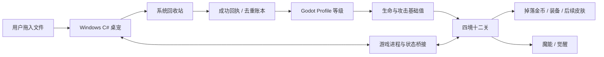

浏览器构建保留战斗系统，使用独立的浏览器存档，不执行这条系统回收路径。

## 仓库导航

```text
prototype/                 Godot完整源码与游戏资源
  v6/                      正式运行入口、玩家和敌人主体
  v5/                      菜单、HUD和共享绘制
  biomes/ campaign/        场景、阵容、关卡和Boss
  rift/ loop/              入场、AI、遗物、连战、掉落、装备
  ascension/               魔能、变身、强化动作与终结
  punch/ foe_vfx/ loot/    命中、敌人招式与拾取表现
  wardrobe/                金币、皮肤与装备数据
  showcase/                当前工程的隔离展示脚本
desktop/lin4run/           桌宠维护源码、构建与上游许可
web/dist/                  可直接部署的浏览器成品
tools/                     构建、素材处理与校验工具
docs/                      使用、玩法、架构、素材与截图
deployment/                自托管配置示例
.github/workflows/         静态校验及GitHub Pages发布
```

详细说明：

- [安装与首次游玩](docs/GETTING_STARTED.md)
- [玩法、成长公式与经济系统](docs/GAMEPLAY.md)
- [开发、构建、回归检查与重录展示](docs/DEVELOPMENT.md)
- [模块架构、数据流与存档](docs/ARCHITECTURE.md)
- [网页部署与国内访问路线](docs/DEPLOYMENT.md)
- [效果图来源与录制条件](docs/media/README.md)
- [变更记录](CHANGELOG.md)
- [贡献方式](CONTRIBUTING.md)
- [问题反馈](https://github.com/LTY4869822/naiwa-riftbound/issues)

## 验证情况

前一轮 PixelFX 交付记录包含 **336 项通过断言与232项资源检查**，明细保存在 [punch-delivery.json](docs/validation/punch-delivery.json)。这是该轮既有记录，不把它包装成每台机器、所有环境或完整十二关通关的保证。

本次公开整理另外重新完成：当前源码导入与展示场运行、最新版截图/动画重录、网页资源分块校验、加载器网络中断/截断/损坏/永久失败分支校验，以及仓库链接和发布包检查。CI 对可分发网页文件继续执行静态与哈希校验。

## 已知边界与后续方向

- 当前是持续迭代的单人原型，难度、手感和首领表现仍需要更多玩家反馈。
- 当前只有原初皮肤，新的皮肤角色资源尚未实装。
- 新增场景和角色部分由生成式图像工具参与制作，来源与测量数据保留在资源目录；不能将全部美术宣传为纯手绘原创。
- 浏览器存档绑定来源，清除站点数据、换浏览器或换域名不会自动找回旧进度。
- GitHub Pages 和原试玩站都不是国内专线；国内正式分发需要另外接入自有域名与合适的托管节点。
- 未宣称完成实体手机适配验收或十二关自然通关测试。
- 未提供商业发行所需的完整素材权利清算。

优先迭代方向：更多实装皮肤、长期成长平衡、首领招式辨识与公平性、输入/性能反馈收集，以及面向国内玩家的稳定分发。

## 致谢与授权

角色、桌宠底座、粒子配方、音频、字体和引擎分别来自不同授权范围。感谢 [yugh6/Naiwa](https://github.com/yugh6/Naiwa)、[LIN4RUN/naiwa-desktop-pet](https://github.com/LIN4RUN/naiwa-desktop-pet)、[patch-gg/pixelfx](https://github.com/patch-gg/pixelfx)、[yuewen-huang/combat-vfx-demo](https://github.com/yuewen-huang/combat-vfx-demo)、[amiaoapp/inkwave](https://github.com/amiaoapp/inkwave)、[Kenney](https://kenney.nl/) 与 Godot、Noto 字体项目。

**署名不代表获得了新的商业授权。** 具体使用范围和完整许可证见 [THIRD_PARTY_NOTICES.md](THIRD_PARTY_NOTICES.md)、[LICENSE.md](LICENSE.md) 及各素材随附文件。

---

**从桌面的一点陪伴，到裂境的一次冒险。**
